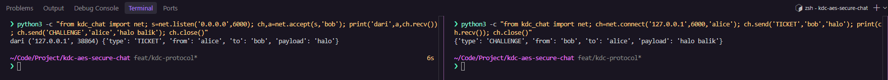
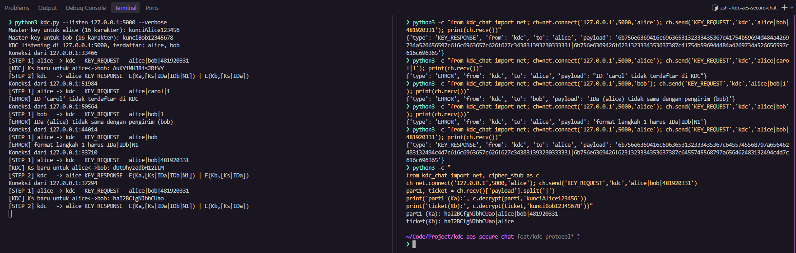
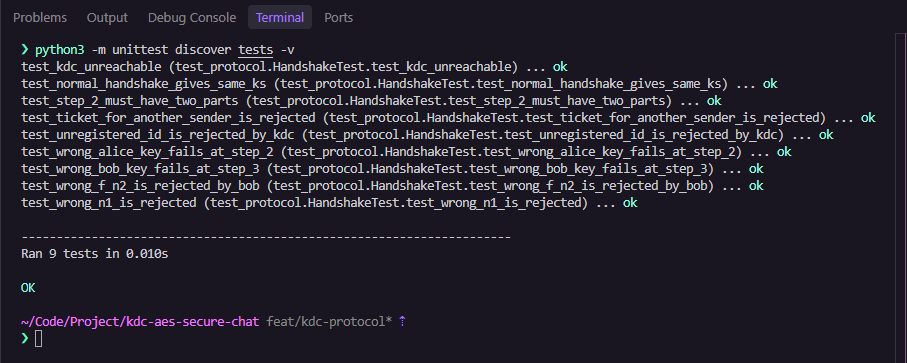
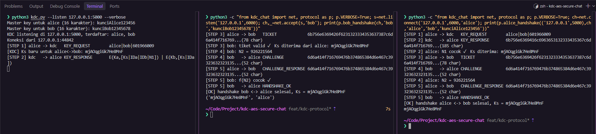
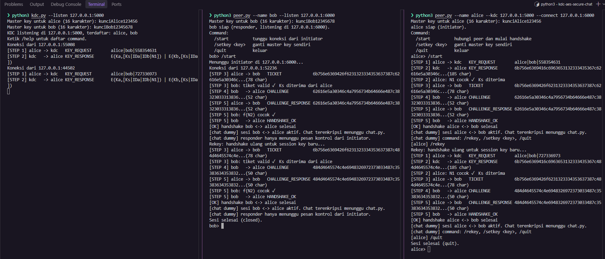
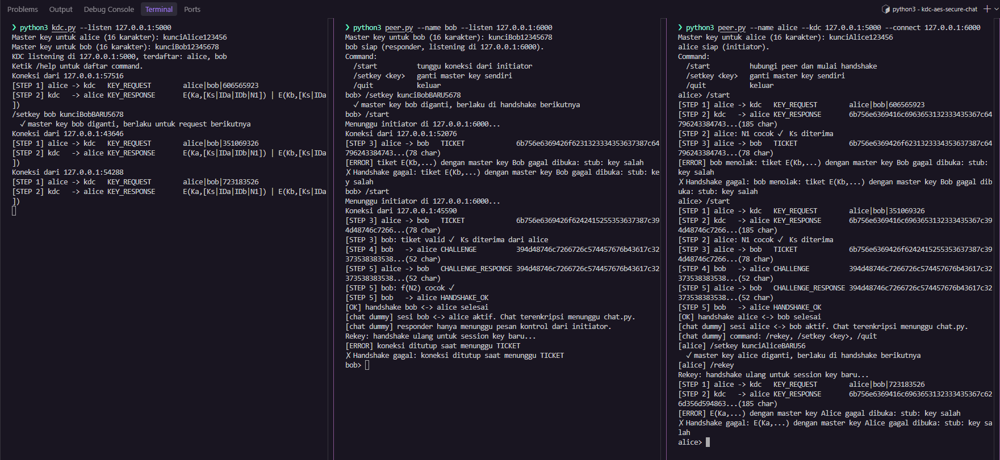

# KDC AES Secure Chat

Aplikasi chat dua arah antara **Alice** dan **Bob** yang kuncinya dibagikan oleh **KDC (Key Distribution Center)**, lalu pesannya dienkripsi dengan **AES yang diimplementasikan manual**. Dibuat untuk Tugas 2 mata kuliah Keamanan Informasi.

# Gambaran umum

Alice dan Bob tidak pernah bertukar kunci secara langsung. Masing-masing hanya berbagi _master key_ dengan KDC. Saat Alice ingin berbicara dengan Bob, KDC membuat _session key_ (Ks) sementara dan membagikannya ke keduanya dengan skenario key distribution lima langkah:

```
(1) A  → KDC : IDa ‖ IDb ‖ N1
(2) KDC → A  : E(Ka, [Ks ‖ IDa ‖ IDb ‖ N1]) ‖ E(Kb, [Ks ‖ IDa])
(3) A  → B   : E(Kb, [Ks ‖ IDa])
(4) B  → A   : E(Ks, N2)
(5) A  → B   : E(Ks, f(N2))
```

Setelah langkah 5, Alice dan Bob saling berkirim pesan yang dienkripsi AES memakai Ks. Kedua pihak bisa menjadi pengirim maupun penerima.

## Arsitektur

```
                 ┌──────────┐
                 │   KDC    │  server
                 └────▲─────┘
                      │ langkah 1–2 (koneksi singkat)
                      │
 ┌──────────┐  langkah 3–5 + chat (satu koneksi TCP, dua arah)  ┌──────────┐
 │  Alice   │ ────────────────────────────────────────────────► │   Bob    │
 └──────────┘ ◄──────────────────────────────────────────────── └──────────┘
```

- **KDC ↔ Alice**: client-server. KDC hanya menunggu dan melayani request.
- **Alice ↔ Bob**: koneksi langsung (peer-to-peer) lewat satu koneksi TCP full-duplex. Chat tidak melewati KDC.
- Tiga proses dijalankan di tiga perangkat dengan IP berbeda.

## Ketentuan utama

- AES dan KDC ditulis manual, tanpa library kriptografi.
- Key dan plaintext berformat ASCII, ciphertext ditampilkan dalam Hex.
- Key bisa diganti saat program berjalan, tidak di-hardcode.
- Hanya memakai Python standard library.

# Struktur proyek

```
kdc_chat/
├── net.py          transport: framing pesan + Channel
├── protocol.py     langkah 1–5 key distribution
├── cipher_stub.py  pengganti AES sementara (dihapus sebelum submit)
├── aes.py          AES manual
├── cipher.py       padding, mode CBC, konversi ASCII/Hex
├── console.py      pembaca input keyboard
└── chat.py         sesi chat dua arah
kdc.py              program KDC
peer.py             program Alice / Bob
tests/              unit test
```

# Kriptografi & Sesi Chat

<!-- TODO: Tambahkan penjelasan tentang kriptografi dan sesi chat -->

# KDC dan jaringan

Bagian ini mencakup lapisan transport yang dipakai KDC, Alice, dan Bob untuk berkomunikasi, server KDC, handshake Alice–Bob, serta program dan command interaktifnya.

## Phase 1 — Transport (`kdc_chat/net.py`)

TCP adalah stream byte tanpa batas pesan, jadi satu pesan bisa sampai terpotong atau tergabung dengan pesan lain. `net.py` menyelesaikan ini dengan **length-prefix framing**:

```
┌────────────────────┬───────────────────────────────┐
│ 4 byte panjang     │ JSON UTF-8                    │
│ (big-endian)       │ {"type","from","to","payload"}│
└────────────────────┴───────────────────────────────┘
```

Penerima membaca 4 byte header untuk tahu panjang pesan, lalu membaca tepat sebanyak itu.

| Komponen                        | Fungsi                                                                                                                  |
| ------------------------------- | ----------------------------------------------------------------------------------------------------------------------- |
| `recv_exact(sock, n)`           | Membaca tepat _n_ byte, mengulang `recv()` sampai terkumpul                                                             |
| `send_frame` / `recv_frame`     | Mengirim dan menerima satu pesan. Pesan di atas 1 MB atau envelope tidak valid ditolak dengan `ValueError`              |
| `Channel`                       | Pembungkus satu koneksi. `send()` aman dipanggil dari banyak thread, `recv()` mengembalikan `None` bila koneksi ditutup |
| `connect` / `listen` / `accept` | Membuka koneksi TCP                                                                                                     |

Aturan penting: pada satu waktu **hanya satu thread yang memanggil `recv()`** pada sebuah `Channel`, karena dua pembaca pada socket yang sama bisa membuat byte frame tercampur.

### Pengujian

Alice (kanan) mengirim `TICKET` ke Bob (kiri), lalu Bob membalas dengan `CHALLENGE`. Keduanya menerima envelope JSON yang utuh.



Cara mengulang pengujian ini, jalankan di dua terminal dari root repo.

Terminal 1 (Bob):

```bash
python3 -c "from kdc_chat import net; s=net.listen('0.0.0.0',6000); ch,a=net.accept(s,'bob'); print('dari',a,ch.recv()); ch.send('CHALLENGE','alice','halo balik'); ch.close()"
```

Terminal 2 (Alice):

```bash
python3 -c "from kdc_chat import net; ch=net.connect('127.0.0.1',6000,'alice'); ch.send('TICKET','bob','halo'); print(ch.recv()); ch.close()"
```

## Phase 2 — KDC server (`kdc.py`, `kdc_chat/protocol.py`)

KDC menyimpan master key setiap pengguna (`Ka` untuk Alice, `Kb` untuk Bob) dan melayani langkah 1–2 dari skenario key distribution.

```
(1) Alice → KDC : KEY_REQUEST   alice|bob|N1                         (plaintext)
(2) KDC → Alice : KEY_RESPONSE  E(Ka,[Ks|alice|bob|N1]) | E(Kb,[Ks|alice])
```

Alur `kdc_handle` untuk setiap koneksi:

1. Terima `KEY_REQUEST`, lalu pecah payload menjadi `IDa|IDb|N1`.
2. Validasi: formatnya tepat tiga bagian, `IDa` sama dengan pengirim, `IDa` berbeda dari `IDb`, keduanya terdaftar, dan `N1` berupa angka.
3. Bangkitkan session key `Ks`: 16 karakter alfanumerik acak dari `secrets` (CSPRNG), sehingga tidak bisa ditebak dari Ks sebelumnya.
4. Buat dua ciphertext **terpisah**, sesuai slide kelas:
   - `part1 = E(Ka, Ks|IDa|IDb|N1)`, hanya bisa dibuka Alice.
   - `ticket = E(Kb, Ks|IDa)`, hanya bisa dibuka Bob. Alice meneruskannya ke Bob pada langkah 3.
5. Kirim `part1|ticket` sebagai `KEY_RESPONSE`, lalu tutup koneksi.

Kalau validasi gagal, KDC mengirim `ERROR` beserta alasannya, mencatatnya di log, dan menutup koneksi itu tanpa menghentikan server. Setiap koneksi dilayani di thread sendiri, jadi satu client yang lambat tidak menahan client lain.

| Komponen                            | Fungsi                                                                    |
| ----------------------------------- | ------------------------------------------------------------------------- |
| `kdc_handle(ch, keys)`              | Melayani satu request langkah 1 → langkah 2                               |
| `new_session_key()` / `new_nonce()` | Membangkitkan Ks dan nonce dengan `secrets`                               |
| `check_key(key)`                    | Memastikan key tepat 16 karakter ASCII yang bisa dicetak                  |
| `HandshakeError`                    | Error verifikasi protokol, dikirim ke lawan sebagai `ERROR`               |
| `kdc.py`                            | Argumen CLI, input master key, loop accept dengan satu thread per koneksi |

> Selama AES milik anggota A belum selesai, enkripsi memakai `cipher_stub.py`. Stub ini **bukan enkripsi**: hex-nya masih memuat key dan plaintext. Stub hanya dipakai untuk menguji alur protokol dan akan dihapus saat integrasi.

### Menjalankan KDC

```bash
python3 kdc.py --listen 0.0.0.0:5000
```

| Argumen     | Default        | Keterangan                              |
| ----------- | -------------- | --------------------------------------- |
| `--listen`  | `0.0.0.0:5000` | Alamat dan port KDC                     |
| `--users`   | `alice,bob`    | ID yang terdaftar, dipisah koma         |
| `--verbose` | mati           | Tampilkan Ks di log, berguna untuk demo |

Saat start, KDC meminta master key untuk setiap ID. Key yang panjangnya bukan 16 karakter ditolak dan diminta ulang.

### Pengujian

Pengujian memakai dua terminal. Terminal kiri menjalankan KDC, terminal kanan berperan sebagai Alice yang mengirim request.



**Persiapan.** Terminal 1 menjalankan KDC dan meminta master key setiap ID (tepat 16 karakter):

```bash
python3 kdc.py --listen 127.0.0.1:5000 --verbose
```

Pada pengujian ini master key Alice `kunciAlice123456` dan master key Bob `kunciBob12345678`.

**1. Request normal.** Terminal 2 mengirim langkah 1 sebagai Alice:

```bash
python3 -c "from kdc_chat import net; ch=net.connect('127.0.0.1',5000,'alice'); ch.send('KEY_REQUEST','kdc','alice|bob|481920331'); print(ch.recv())"
```

KDC menjawab `KEY_RESPONSE` yang payload-nya berisi dua hex dipisah `|` (kiri `part1`, kanan `ticket`). Di log KDC muncul `[STEP 1]`, session key baru (karena `--verbose`), lalu `[STEP 2]`.

**2. Request ditolak.** Tiga request yang salah, masing-masing dijawab `ERROR` dan KDC tetap berjalan:

| Request                            | Respons `ERROR`                                |
| ---------------------------------- | ---------------------------------------------- |
| `alice\|carol\|1`                  | `ID 'carol' tidak terdaftar di KDC`            |
| `alice\|bob\|1` dikirim oleh `bob` | `IDa (alice) tidak sama dengan pengirim (bob)` |
| `alice\|bob` (tanpa N1)            | `format langkah 1 harus IDa\|IDb\|N1`          |

Contohnya untuk ID yang tidak terdaftar:

```bash
python3 -c "from kdc_chat import net; ch=net.connect('127.0.0.1',5000,'alice'); ch.send('KEY_REQUEST','kdc','alice|carol|1'); print(ch.recv())"
```

Setelah ketiga request itu, request normal tetap dilayani. Artinya error satu client tidak menghentikan KDC.

**3. Isi hex dibuka dengan key masing-masing.** Karena masih memakai stub, hex dari KDC bisa dibuka untuk membuktikan isinya benar:

```bash
python3 -c "
from kdc_chat import net, cipher_stub as c
ch=net.connect('127.0.0.1',5000,'alice'); ch.send('KEY_REQUEST','kdc','alice|bob|481920331')
part1, ticket = ch.recv()['payload'].split('|')
print('part1 (Ka):', c.decrypt(part1,'kunciAlice123456'))
print('ticket(Kb):', c.decrypt(ticket,'kunciBob12345678'))"
```

```
part1 (Ka): haI2BCfgNJbhCUao|alice|bob|481920331
ticket(Kb): haI2BCfgNJbhCUao|alice
```

Hasil ini sesuai dengan slide 13:

- `part1` dibuka dengan Ka dan berisi `Ks|IDa|IDb|N1`. N1 sama dengan yang dikirim Alice (`481920331`), jadi Alice bisa memastikan jawaban ini bukan replay.
- `ticket` dibuka dengan Kb dan berisi `Ks|IDa`.
- Ks di kedua bagian **sama** (`haI2BCfgNJbhCUao`). KDC memberi session key yang sama ke Alice dan Bob lewat dua jalur terpisah.
- Pada screenshot, Ks tiap request berbeda (`AuKYiMHJBisJRfVY`, `dUtUhyzedbH12ILM`, `haI2BCfgNJbhCUao`), jadi session key dibuat baru setiap kali.

## Phase 3 — Handshake langkah 1–5 (`kdc_chat/protocol.py`)

Phase ini melengkapi sisi Alice dan Bob, sehingga kelima langkah berjalan dari awal sampai akhir.

```
(1) Alice → KDC   KEY_REQUEST         alice|bob|N1
(2) KDC   → Alice KEY_RESPONSE        E(Ka,[Ks|alice|bob|N1]) | E(Kb,[Ks|alice])
(3) Alice → Bob   TICKET              E(Kb,[Ks|alice])
(4) Bob   → Alice CHALLENGE           E(Ks, N2)
(5) Alice → Bob   CHALLENGE_RESPONSE  E(Ks, f(N2))        f(N2) = N2 + 1
    Bob   → Alice HANDSHAKE_OK        (konfirmasi, di luar 5 langkah)
```

**`alice_handshake(kdc_addr, bob_ch, me, peer, ka)`** mengembalikan Ks:

1. Membuka koneksi ke KDC, mengirim langkah 1 dengan nonce N1 baru, menerima langkah 2, lalu menutup koneksi KDC.
2. Memecah payload menjadi `part1|ticket` dan membuka `part1` dengan Ka.
3. Memeriksa bahwa IDa dan IDb sesuai permintaan dan **N1 sama dengan yang dikirim**. Ini membuktikan jawaban KDC memang untuk request ini, bukan replay jawaban lama.
4. Meneruskan `ticket` ke Bob apa adanya (langkah 3). Alice tidak bisa membukanya karena dienkripsi Kb.
5. Membuka N2 dari Bob dengan Ks, lalu membalas `E(Ks, N2 + 1)` (langkah 5).

**`bob_handshake(alice_ch, me, kb)`** mengembalikan `(Ks, ID Alice)`:

1. Membuka tiket dengan Kb dan memeriksa bahwa IDa di dalam tiket sama dengan pengirimnya.
2. Membuat nonce N2 baru, mengirim `E(Ks, N2)` (langkah 4).
3. Memeriksa jawaban Alice sama dengan `f(N2)`. Hanya pihak yang memegang Ks yang bisa menjawab dengan benar, jadi tiket lama yang diputar ulang oleh penyerang akan gagal di sini.
4. Mengirim `HANDSHAKE_OK`.

Setelah langkah 5, Alice dan Bob memegang Ks yang sama tanpa Ks pernah dikirim dalam bentuk plaintext.

**Penanganan error.** Setiap kegagalan verifikasi menghasilkan `HandshakeError`. Pihak yang mendeteksi kesalahan mengirim `ERROR` beserta alasannya ke lawan, sehingga kedua sisi tahu kenapa handshake gagal. Pihak yang _menerima_ `ERROR` tidak membalas dengan `ERROR` lagi. Program tidak crash, dan penutupan koneksi Alice–Bob diserahkan ke pemanggil (`peer.py`, Phase 4).

| Kegagalan                            | Terdeteksi di            | Pesan                                                 |
| ------------------------------------ | ------------------------ | ----------------------------------------------------- |
| KDC tidak bisa dihubungi             | Alice, sebelum langkah 1 | `tidak bisa terhubung ke KDC ...`                     |
| ID tidak terdaftar                   | KDC, langkah 1           | `kdc menolak: ID '...' tidak terdaftar di KDC`        |
| Master key Alice salah               | Alice, langkah 2         | `E(Ka,...) dengan master key Alice gagal dibuka`      |
| N1 tidak cocok                       | Alice, langkah 2         | `N1 tidak cocok`                                      |
| Format langkah 2 bukan dua bagian    | Alice, langkah 2         | `format langkah 2 harus E(Ka,...)\|E(Kb,...)`         |
| Master key Bob berbeda dengan di KDC | Bob, langkah 3           | `tiket E(Kb,...) dengan master key Bob gagal dibuka`  |
| IDa di tiket bukan pengirim          | Bob, langkah 3           | `IDa di tiket (...) tidak sama dengan pengirim (...)` |
| Jawaban challenge salah              | Bob, langkah 5           | `f(N2) salah`                                         |

### Unit test

```bash
python3 -m unittest discover tests -v
```



`tests/test_protocol.py` menjalankan KDC dan Bob sebagai thread di localhost, lalu menguji Alice terhadap keduanya. Untuk kasus yang tidak bisa dibuat oleh KDC asli (N1 salah, format langkah 2 salah), test memakai KDC palsu. Untuk kasus f(N2) salah dan tiket milik orang lain, test memakai Alice palsu. Ada 9 test: handshake normal, dan 8 kasus gagal dari tabel di atas.

### Pengujian manual (tiga terminal)

Pengujian ini dibuat sebelum `peer.py` ada (Phase 4), jadi Alice dan Bob dijalankan dengan `python3 -c` untuk memanggil fungsi handshake secara langsung. Master key sama dengan pengujian Phase 2.

Terminal 1 (KDC):

```bash
python3 kdc.py --listen 127.0.0.1:5000 --verbose
```

Terminal 2 (Bob):

```bash
python3 -c "from kdc_chat import net, protocol as p; p.VERBOSE=True; s=net.listen('127.0.0.1',6000); ch,_=net.accept(s,'bob'); print(p.bob_handshake(ch,'bob','kunciBob12345678'))"
```

Terminal 3 (Alice):

```bash
python3 -c "from kdc_chat import net, protocol as p; p.VERBOSE=True; ch=net.connect('127.0.0.1',6000,'alice'); print(p.alice_handshake(('127.0.0.1',5000),ch,'alice','bob','kunciAlice123456'))"
```



Contoh log di sisi Alice:

```
[STEP 1] alice -> kdc   KEY_REQUEST        alice|bob|816217
[STEP 2] kdc   -> alice KEY_RESPONSE       6b756e6369416c6963653132333435367c334d6a32587a32...(179 char)
[STEP 2] alice: N1 cocok ✓  Ks diterima: 3Mj2Xz2jNSGWDqu9
[STEP 3] alice -> bob   TICKET             6b756e6369426f6231323334353637387c334d6a32587a32...(78 char)
[STEP 4] bob   -> alice CHALLENGE          334d6a32587a326a4e534757447175397c33333336333030...(52 char)
[STEP 4] alice: N2 = 333630015
[STEP 5] alice -> bob   CHALLENGE_RESPONSE 334d6a32587a326a4e534757447175397c33333336333030...(52 char)
[STEP 5] bob   -> alice HANDSHAKE_OK
[OK] handshake alice <-> bob selesai, Ks = 3Mj2Xz2jNSGWDqu9
```

Ks yang dicetak KDC, Alice, dan Bob harus sama. Untuk mencoba kasus gagal, jalankan Bob dengan master key lain, misalnya `kunciBobSALAH123`. Handshake akan berhenti di langkah 3 dengan pesan `tiket E(Kb,...) dengan master key Bob gagal dibuka`.

## Phase 4 — Program Alice/Bob dan command interaktif (`peer.py`, `kdc.py`)

Phase ini membuat program yang bisa dipakai langsung, tanpa `python3 -c`. Master key bisa diganti saat program berjalan, dan session key bisa diperbarui tanpa restart.

### Peran initiator dan responder

`peer.py` dipakai untuk Alice maupun Bob. Perannya ditentukan oleh argumen:

| Peran             | Argumen                 | Tugas                                                                 |
| ----------------- | ----------------------- | --------------------------------------------------------------------- |
| Initiator (Alice) | `--connect` dan `--kdc` | Menghubungi responder, meminta Ks ke KDC, menjalankan langkah 1–5     |
| Responder (Bob)   | tanpa `--connect`       | Menunggu koneksi di `--listen`, menjalankan sisi Bob dari langkah 3–5 |

```bash
python3 peer.py --name bob   --listen 0.0.0.0:6000
python3 peer.py --name alice --kdc <IP_KDC>:5000 --connect <IP_BOB>:6000
```

| Argumen     | Default        | Keterangan                                                     |
| ----------- | -------------- | -------------------------------------------------------------- |
| `--name`    | (wajib)        | ID peer ini, misalnya `alice` atau `bob`                       |
| `--connect` | –              | `host:port` responder. Kalau diisi, peer ini menjadi initiator |
| `--kdc`     | –              | `host:port` KDC, wajib untuk initiator                         |
| `--peer`    | `bob`          | ID responder yang dituju initiator                             |
| `--listen`  | `0.0.0.0:6000` | Alamat responder menunggu koneksi                              |
| `--verbose` | mati           | Tampilkan Ks dan nonce di log                                  |

Saat start, peer meminta master key-nya sendiri (tepat 16 karakter), lalu menampilkan menu.

### Alur program

```
menu ──/start──► handshake 1–5 ──► sesi chat ──/rekey──► handshake 1–5 lagi ──► sesi chat ...
  ▲                   │                 │
  │             gagal │           /quit │ atau lawan menutup koneksi
  └───────────────────┴─────────────────┘
```

- Handshake yang gagal tidak menghentikan program. Pesan error ditampilkan, koneksi Alice–Bob ditutup, dan kedua peer kembali ke menu.
- `/rekey` memakai koneksi Alice–Bob yang sama. Alice mengirim `REKEY`, Bob membalas `REKEY_ACK`, lalu keduanya menjalankan langkah 1–5 lagi dan mendapat Ks baru dari KDC. Sesuai slide 14, umur session key sebaiknya dibatasi, dan `/rekey` adalah cara menggantinya tanpa memutus koneksi.

### Command

| Program                   | Command              | Fungsi                                                            |
| ------------------------- | -------------------- | ----------------------------------------------------------------- |
| KDC                       | `/setkey <id> <key>` | Ganti master key `<id>`, atau daftarkan ID baru                   |
| KDC                       | `/list`              | Tampilkan ID dan master key yang terdaftar                        |
| KDC                       | `/quit`              | Hentikan KDC                                                      |
| Alice/Bob (menu)          | `/start`             | Alice: hubungi Bob dan mulai handshake. Bob: tunggu koneksi Alice |
| Alice/Bob (menu dan sesi) | `/setkey <key>`      | Ganti master key sendiri, berlaku di handshake berikutnya         |
| Alice (sesi)              | `/rekey`             | Minta session key baru ke KDC                                     |
| Alice/Bob                 | `/quit`              | Keluar dari sesi atau program                                     |

Master key bersifat _pre-shared_: KDC dan pemilik key harus mengganti key yang sama. Kalau hanya salah satu yang mengganti, handshake berikutnya gagal. Ini sengaja dipakai sebagai test case.

Agar KDC bisa menerima command sambil tetap melayani request, loop `accept` dijalankan di thread latar belakang, dan thread utama membaca command. `kdc_handle` membaca master key dari dict yang sama, jadi `/setkey` langsung berlaku untuk request berikutnya.

> **Sesi chat masih dummy.** Chat terenkripsi adalah bagian anggota A (`chat.py`). Sampai integrasi, `peer.py` memakai `dummy_chat` yang hanya menangani pesan kontrol `REKEY`, `REKEY_ACK`, dan `BYE`, sehingga alur `/rekey` dan `/quit` bisa diuji. Di sesi dummy, responder belum bisa mengetik command dan pesan biasa belum dikirim.

### Pengujian

Jalankan tiga terminal. Master key sama dengan pengujian sebelumnya.

```bash
python3 kdc.py --listen 127.0.0.1:5000
```

```bash
python3 peer.py --name bob --listen 127.0.0.1:6000
```

```bash
python3 peer.py --name alice --kdc 127.0.0.1:5000 --connect 127.0.0.1:6000
```

Skenario yang diuji, berurutan:

| #   | Langkah                                                         | Hasil yang diharapkan                                                                              |
| --- | --------------------------------------------------------------- | -------------------------------------------------------------------------------------------------- |
| 1   | Bob `/start`, lalu Alice `/start`                               | Handshake 1–5 berhasil, keduanya masuk sesi                                                        |
| 2   | Alice `/rekey`                                                  | Handshake diulang di koneksi yang sama, Ks baru dari KDC                                           |
| 3   | Alice `/quit`                                                   | Sesi Alice selesai (`quit`), Bob melihat sesi selesai (`closed`), keduanya kembali ke menu         |
| 4   | Bob `/setkey kunciBobBARU5678`, lalu `/start` di kedua peer     | Gagal di langkah 3: `tiket E(Kb,...) dengan master key Bob gagal dibuka`. Keduanya kembali ke menu |
| 5   | KDC `/setkey bob kunciBobBARU5678`, lalu `/start` di kedua peer | Berhasil lagi **tanpa restart**                                                                    |
| 6   | Alice `/setkey kunciAliceBARU56` di dalam sesi, lalu `/rekey`   | Gagal di langkah 2: `E(Ka,...) dengan master key Alice gagal dibuka`, karena KDC belum diganti     |
| 7   | `/setkey pendek`                                                | Ditolak: `key harus tepat 16 karakter`                                                             |




